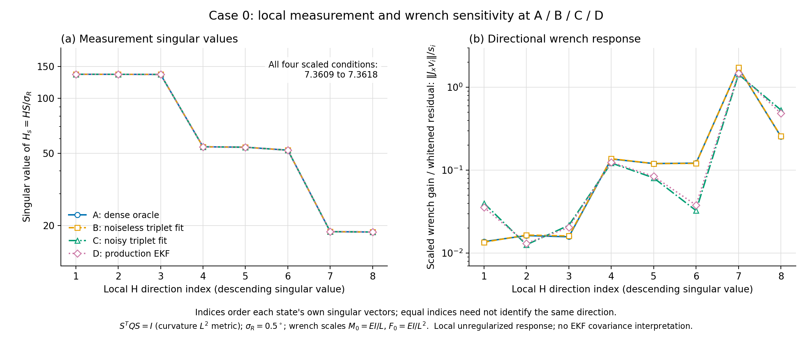
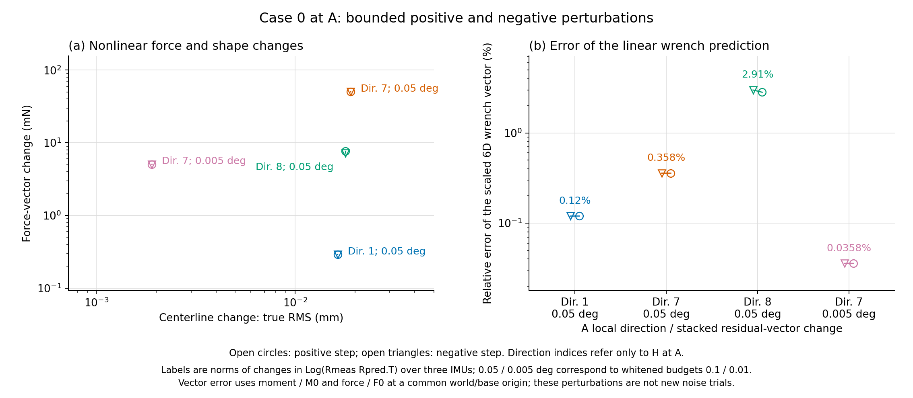

# Step 2: local orientation-to-wrench sensitivity

On this fixed case, the three-IMU measurement map is moderately conditioned after physical modal scaling, but particular modal changes cause much larger wrench changes than others. A combined residual-vector change of about 0.05 degrees produces about 50 mN of force change along one tested direction, versus 0.29 mN along the strongest measurement direction, with similar small centerline changes. This supports local mechanical amplification as a contributor to the saved noisy-wrench errors. It does not identify the cause of the manuscript aggregate result.

## Fixed scope and provenance

Date: 2026-10-12 (America/New_York). Source branch `diagnostic/oracle-ekf-gap`, HEAD `9a994c4dde921c07150072fa55c8bf3f19d0364f`. Case 0, noise realization 0, order `(2,2,1)`, gamma 10, actual sensor positions `[25/99, 50/99, 1]`, nominal orientation sigma 0.5 degrees. Tendon tensions, routing, material parameters, frame and origin are fixed.

The four modal states are reused from Step 1 `after_abcd/results.json`: A dense GT Oracle, B noiseless three-IMU offline fit, C noisy three-IMU offline fit, D corrected production EKF. No fitting or EKF updates were rerun. Closure access uses `steps=0` only. A used 100 dense GT orientations; B used one noiseless triplet; C/D share one saved noisy triplet. Saved D reused that frame for 30 updates; those are not independent observations.

The actual saved noise has stacked nominally whitened norm 3.660920. The controlled perturbations below have budgets 0.1 and 0.01 in that same stacked norm, rather than a per-sensor 0.1-sigma noise injection.

## Coordinates and estimator preservation

Let `Q = blockdiag(Gram(2), Gram(2), Gram(1))`, where `Gram(p)[i,j]=1/(i+j+1)`. With `S=chol(Q)^(-T)` and `m=S q`, `||delta q||^2` equals the integral of squared normalized curvature/torsion changes. This is an angular-strain RMS metric, not stiffness energy or the EKF prior.

The measurement residual is `r(m)=stack Log(R_meas R_pred(m)^T)`, with observations held fixed. Use `H_s=(dr/dm) S/sigma`. Whitening uses the nominal isotropic covariance for one triplet, not an exact finite-residual noise transformation or a factor of sqrt(30).

Wrenches use world axes and a fixed world/base origin, ordered `[moment, force]`. The physical scales are `M0=EI/L=0.0294524311274 N m` and `F0=EI/L^2=0.294524311274 N`; `x=Dw^(-1) w`, `Dw=diag(M0 I3,F0 I3)`.

Every wrench is evaluated by the original body-tip pseudoinverse with `rcond=1e-8`, then transformed to world/base. All six original singular directions remain retained. The dimensionless matrix `B=A_base Dw/M0` changes unknown coordinates and applies a uniform residual scale; it does not change the LS objective. We do not solve an unweighted system after multiplying generalized-load rows by `S.T`. Such a change would reweight this overdetermined estimator.

## Measurement and mechanics spectra

| State | Scaled H condition | Scaled body-tip wrench condition | Scaled common-base wrench condition | Largest gain among local H directions |
|---|---:|---:|---:|---:|
| A | 7.3618 | 769.23 | 798.41 | 1.7175 |
| B | 7.3618 | 771.32 | 800.61 | 1.7263 |
| C | 7.3609 | 722.39 | 749.33 | 1.4321 |
| D | 7.3611 | 726.37 | 753.55 | 1.4740 |

At A the raw monomial-coordinate measurement condition is 137.79; curvature normalization gives 7.3618. Its nine-by-eight Jacobian retains eight local singular directions. This is not evidence of severe measurement ill-conditioning in the chosen physical metric, and it is not proof of global or dynamic observability.

The scaled weakest body-tip mechanics direction has 99.64% of its squared vector norm in force components and 85.32% in body Fz. It is predominantly body-Fz with a substantial transverse mixture, not a purely axial direction. These mechanics conditions retain the original monomial-row residual metric and are not coordinate-invariant rod properties. Do not treat differently scaled H and A condition numbers as directly comparable evidence.

For each local right singular vector v of H_s, the gain is `||J_x v|| / singular_value(H_s)`, where `J_x=dx/dq`. Indices are ordered independently at each state; the same index across A/B/C/D need not be the same vector.

At A, direction 7 has the largest gain **among H singular directions**, 1.717455. The full local composition operator has norm 1.745496. `+J_x pinv(H_s)` maps state-induced residual changes to wrench changes. Compensating an externally added residual uses the opposite sign, with the relevant SO(3) observation derivative. Gain norms do not depend on that sign. This composition is not the EKF gain or posterior covariance.



## Full least-squares derivative

With the common-base equation `A(m) w = b(m,tau)` and residual `e=b-Aw`, differentiating the retained full-column-rank LS solution gives:

```text
(A.T A) dw = A.T (db - dA w) + dA.T e
```

The code evaluates db and dA with centered differences, then uses SVD to evaluate all terms without explicitly inverting the normal matrix. Both rotation and tip-position changes enter dA through the shape-dependent body-tip/common-base transform. It compares the complete derivative with direct differences of the unchanged production wrench pipeline.

| State | Full derivative relative FD error | Error if residual term is dropped | Error if only db is retained |
|---|---:|---:|---:|
| A | 1.51e-09 | 0.051% | 14.813% |
| B | 1.75e-09 | 0.218% | 14.846% |
| C | 3.73e-09 | 13.578% | 26.250% |
| D | 2.9e-09 | 11.560% | 23.742% |

Measurement finite-difference errors are below 3.72e-10. Halving the wrench-difference step at A changes the direct derivative by 4.57e-09 relatively. The q-coordinate difference steps are 1e-6 for measurement H and 1e-5 for the wrench map; only A has the additional 5e-6 convergence check.

## Controlled nonlinear check

At A, use the strongest measurement direction (1), weakest measurement direction (8), and largest coupled gain among the measurement directions (7). Both signs are tested at stacked whitened target 0.1; direction 7 is also tested at 0.01. The step is `min(target/singular_value,0.05)` in curvature-RMS units. The cap is inactive in all eight tests. These are hypothetical modal-state perturbations with observations and tensions fixed, not new physical GT cases, injected noise trials or new EKF runs.

| A local direction | Stacked residual-vector change | Force-vector change (mN) | Centerline change, true RMS (mm) | Scaled wrench-vector prediction error |
|---|---:|---:|---:|---:|
| 1 | 0.05 deg | 0.289–0.290 | 0.016364–0.016364 | 0.1198–0.1199% |
| 7 | 0.005 deg | 5.049–5.052 | 0.001903–0.001903 | 0.0358–0.0358% |
| 7 | 0.05 deg | 50.326–50.687 | 0.019029–0.019039 | 0.3579–0.3579% |
| 8 | 0.05 deg | 7.217–7.629 | 0.017957–0.017959 | 2.8235–2.9892% |

The angle is the norm of the **change of the stacked SO(3)-log residual vectors**, not an error independently applied to every sensor or a direct orientation geodesic distance. Force and centerline numbers are changes from A, not errors against GT. The vector prediction error includes moment/M0 and force/F0 at the common origin.

The strongest measurement direction and direction 7 have similarly small centerline changes, but their inferred force changes differ by approximately 175 times. This is more direct local amplification evidence than raw condition numbers alone. The tenfold smaller direction-7 perturbation reduces the linear prediction error tenfold.



## Relating the saved estimates

For each finite A-to-B/C/D change, the code retains the vectors and verifies:

```text
A_i (w_i - w_A) = delta_b - delta_A w_A - delta_e
```

The closure error is below 7.3e-18 N m. The stored S.T row conversion is for displaying generalized-work covectors only; it does not change the estimator. Term vectors must be compared with their cancellations, not by adding their norms.

The local wrench derivative at A predicts the saved A-to-B/C/D scaled wrench changes with relative errors 0.37% (B), 7.31% (C), 6.22% (D). Those finite changes are not infinitesimal, so the remaining differences are not evidence of a derivative bug.

## Preservation and next action

Production implementations, datasets, saved states and historical diagnostic evidence are unchanged. The only edit to a preexisting file is the English diagnostic README index. `baseline_manifest.json` records all 461 non-cache tracked files, including 49 production Python files; tracked cache files are explicitly excluded. Input/source checks inside the driver also preserve repository status.

One fixed case with exact tendon tensions supports local amplification in this estimator. It does not establish a global/dynamic observability claim, a filter uncertainty distribution, a hardware noise model, or the aggregate cause of the manuscript force-direction mean of 44.2 degrees. The analysis omits tension, routing and stiffness uncertainty. The earlier legacy-EKF derivative limitations are unchanged.

Recommended next action: confirm the same sensitivity pattern on two additional existing cases, selected by case ID before inspecting their errors, before changing the estimator. If the local gains do not recur despite large wrench errors, reconsider model projection, noise/prior behavior and other mechanisms rather than generalizing this case.

## Reproduce

From the repository root, use fresh output names:

```powershell
& '.\.venv\Scripts\python.exe' -B diagnostics/oracle_ekf_gap/step2_sensitivity_20261012/diagnose_sensitivity.py --output-dir "$env:TEMP/step2-sensitivity-new"
& '.\.venv\Scripts\python.exe' -B diagnostics/oracle_ekf_gap/step2_sensitivity_20261012/render_figures.py --results "$env:TEMP/step2-sensitivity-new/results.json"
```

Both commands refuse existing result/figure files. `results/results.json` contains complete matrices, direction vectors, source/input hashes and the actual execution command. `summary.csv` and `perturbations.csv` provide compact numeric outputs.
