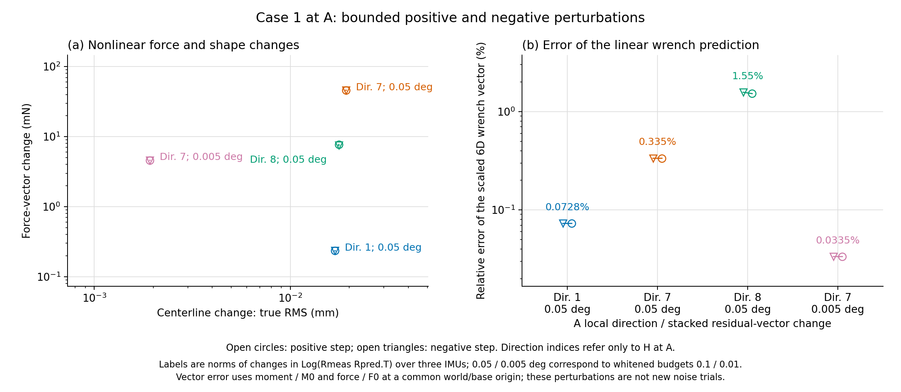
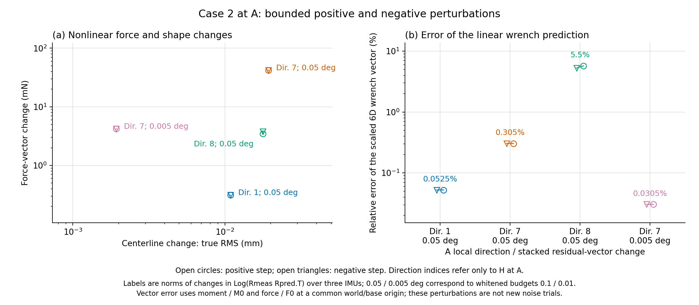

# Step 3: does the local wrench amplification recur on two more cases?

Yes. On existing cases 1 and 2, chosen by case ID before their errors were computed, the same pattern appears as in case 0: the measurement map stays moderately conditioned (scaled condition 7.32 and 7.36), yet a 0.05 degree stacked residual change along one local direction changes the inferred force by 42–46 mN, versus 0.23–0.31 mN along the strongest measurement direction. The preregistered recurrence rule is met in both new cases, with scaled-wrench ratios of 125 and 102 against a threshold of 10.

A post hoc decomposition, not part of the protocol, adds that this one direction accounts for most of the saved noisy wrench error in all three cases. These are three physical cases sharing one saved noise pattern, so the result is not a population estimate and does not establish the cause of the manuscript aggregate.

## Fixed scope and provenance

Date: 2026-10-12 (America/New_York). Source branch `diagnostic/oracle-ekf-gap`, HEAD `a33a6b8c03baaf2cb78f4c2f34f720dcc04c3d5a`. Cases 1 and 2, noise realization 0, order `(2,2,1)`, gamma 10, actual sensor positions `[25/99, 50/99, 1]`, nominal orientation sigma 0.5 degrees, 30 static EKF updates. All settings match Steps 1 and 2.

`protocol.json` was written before any case 1/2 outcome was computed. `run_registration.json` records its SHA256 and the A/B/C/D runner SHA256 at launch. The protocol fixes the case IDs (the first two additional IDs in the dataset), the three offline starts and their selection by orientation-residual cost only, the perturbation design, and the recurrence rule with its descriptive threshold of 10. No replacement cases, new noise draws, extra starts or tuning were used.

The dataset generator broadcasts each noise realization across cases. The saved noise has stacked whitened norm 3.660920 in all three cases. They are three distinct physical cases under one shared noise pattern, not independent noise trials.

## Fresh A/B/C/D results for the new cases

A is the dense GT oracle, B the noiseless three-IMU offline fit, C the noisy three-IMU offline fit, D the corrected production EKF. Case 0 values are the preserved Step 1 results; cases 1 and 2 were run fresh with the same runner logic. In every fit, all three starts converged to the same residual.

| Case | Tendon tensions (N) | GT force (N) | D shape RMS (mm) | C force error (N) | C direction error | D force error (N) | D direction error |
|---|---|---:|---:|---:|---:|---:|---:|
| 0 | `[0, 1.858, 0, 0]` | 0.283 | 0.553 | 0.779 | 94.0 deg | 0.647 | 89.3 deg |
| 1 | `[0, 0, 0, 2.176]` | 0.227 | 0.749 | 0.980 | 94.4 deg | 0.920 | 93.8 deg |
| 2 | `[2.595, 0, 0, 1.526]` | 0.301 | 0.673 | 0.406 | 17.4 deg | 0.388 | 17.1 deg |

A and B stay accurate in both new cases (force error at most 9.1 mN, direction error at most 2.3 degrees). The noisy fit C and the EKF D agree closely with each other, so the error comes with the noisy triplet rather than with the filter recursion. The force error exceeds the GT force magnitude in all three cases; the direction error varies from 17 to 94 degrees depending on the case.

## Preregistered recurrence check

Coordinates, scaling, the unchanged body-tip pseudoinverse (`rcond=1e-8`) and the full least-squares derivative are exactly those of [Step 2](../step2_sensitivity_20261012/README.md). Perturbations are applied at A with observations and tensions fixed, at stacked whitened budget 0.1 (0.05 degrees), both signs.

| Case | Scaled H condition at A | Largest gain among H directions at A | Force change, strongest H direction (mN) | Force change, largest-gain direction (mN) | Force ratio | Scaled-wrench ratio | Rule met |
|---|---:|---:|---:|---:|---:|---:|---|
| 0 (baseline) | 7.3618 | 1.7175 | 0.289–0.290 | 50.33–50.69 | 174–175 | 124–125 | (reference) |
| 1 | 7.3191 | 1.5587 | 0.234–0.234 | 45.65–45.96 | 195–196 | 125–126 | yes |
| 2 | 7.3558 | 1.4278 | 0.311–0.312 | 41.85–42.10 | 134–135 | 102–102 | yes |

In each case the largest-gain direction is local direction 7 at A, one of the two weakest measurement directions (singular values about 18.6, versus about 136 for the strongest). The index is ordered separately in each case; equal indices are not claimed to be the same modal vector across cases.

All rule conditions hold in both new cases:

- All six body-tip singular directions and all eight measurement directions are retained at A/B/C/D.
- The measurement Jacobian matches finite differences within 3.3e-10, and the full wrench derivative within 5.0e-09 relative error. Halving the difference step at A changes the derivative by at most 6.5e-09.
- Every 0.1-budget perturbation reaches its target and the curvature cap is never active.
- Centerline changes are 0.011–0.019 mm RMS for both directions being compared.
- The tenfold smaller direction-7 perturbation scales the force change tenfold (4.58 and 4.20 mN) and reduces the linear prediction error tenfold.

Raw monomial-coordinate measurement conditions at A are 138.94 and 139.00, as in case 0 (137.79); curvature scaling again brings them to about 7.3. Scaled common-base wrench conditions range from 667 to 740 across the new A/B/C/D states. Dropping the residual term from the derivative costs up to 4.0% in case 1 and 18.9% in case 2 at the noisy states, so the complete expression is still required.

Per-case figures: [case 1 spectra](case_1/sensitivity_verified/local_sensitivity_spectra.png), [case 1 perturbations](case_1/sensitivity_verified/controlled_perturbations.png), [case 2 spectra](case_2/sensitivity_verified/local_sensitivity_spectra.png), [case 2 perturbations](case_2/sensitivity_verified/controlled_perturbations.png).





## Post hoc: where the saved noisy error lies

This section was added after seeing the results and is not covered by the protocol. It uses only saved vectors. The A-to-C and A-to-D modal changes are expressed in the eight local H directions at A, and each component is mapped through the wrench derivative at A.

| Case | State | Largest-gain direction: share of squared modal change | Share of linearized wrench change | That direction alone vs actual wrench change: cosine | Relative error | Full linear prediction error |
|---|---|---:|---:|---:|---:|---:|
| 0 | C | 26% | 84% | 0.9992 | 22% | 7.3% |
| 0 | D | 24% | 82% | 0.9992 | 23% | 6.2% |
| 1 | C | 93% | 105% | 0.9997 | 17% | 11.7% |
| 1 | D | 92% | 103% | 0.9996 | 15% | 11.0% |
| 2 | C | 21% | 85% | 0.9920 | 20% | 33.6% |
| 2 | D | 21% | 85% | 0.9920 | 18% | 32.8% |

In all three cases the actual saved wrench error points almost exactly along the wrench response of the single largest-gain direction, and that direction supplies 82–105% of the linearized change (a share above 100% means the other directions partly cancel it). The saved noise projects onto this direction with a linearized whitened residual of about 1.0–2.5, an ordinary amount for a nine-component residual of norm 3.66; no unusual noise draw is needed to produce these force errors.

The shares are projections onto the linear prediction, and the saved state changes are finite. In case 2 the linear prediction overshoots the actual change by a third, so its percentages are approximate. Because the three cases share one noise pattern, the similar projections are not independent confirmations.

## Driver changes and one preserved failure

The Step 2 numerical kernel (`sensitivity_math.py`) is byte-identical. Two runners gained case selection only:

- `diagnose_recovered.py` adds `--case-id` and `--noise-realization`, resolves the case ID separately in the GT and IMU arrays, and validates shapes and metadata before creating output.
- `diagnose_sensitivity.py` adds `--state-results` to read a chosen case's saved A/B/C/D states. `render_figures.py` takes the case number for its titles from the results.

The first sensitivity launch failed for cases 1 and 2 before any computation, because the hash-protection step assumed the saved states were inside the repository. The fix changes only how protected paths are keyed. The failed logs are kept in `first_attempt_path_failure/`; the script bytes of that first launch were overwritten by the fix and are not preserved. The corrected driver was then rerun on case 0 and reproduces every committed Step 2 number with zero difference (`case_0/sensitivity_verified/`).

After installation, case 1 was rerun end to end from the scripts in this directory. The fitted states, metrics and all sensitivity numbers match the saved results with zero difference.

Log files end with two `fsmonitor_ipc__send_query` lines from Git's file monitor; they do not affect the checks, which run with `core.fsmonitor=false`.

## Preservation and limits

Production code, datasets, saved states and earlier diagnostic evidence are unchanged. `baseline_manifest.json` records all 473 non-cache tracked files at the start; `verification.json` confirms that the only preexisting file edited is the diagnostic README index. The Step 2 directory is untouched, including its scripts.

Three cases with exact tendon tensions and one shared noise pattern support a recurring local mechanism in this estimator: weakly measured modal directions that the mechanics map amplifies into force. This is not a statistical recurrence rate, a global or dynamic observability result, a filter covariance statement, or the established cause of the manuscript force-direction mean of 44.2 degrees. Tension, routing and stiffness uncertainty are still omitted.

Recommended next action: before changing the estimator, test whether the amplified direction is stable across the dataset and across the other four saved noise realizations, since a remedy (a prior or regularization on that direction, or a sensor layout that measures it better) only makes sense if the direction is consistent. That check needs no new data and no production change.

## Reproduce

From the repository root, with fresh output names:

```powershell
$step = 'diagnostics/oracle_ekf_gap/step3_confirmation_20261012'
& '.\.venv\Scripts\python.exe' -B "$step/diagnose_recovered.py" --case-id 1 --noise-realization 0 --output-dir "$env:TEMP/step3-new/abcd"
& '.\.venv\Scripts\python.exe' -B "$step/diagnose_sensitivity.py" --state-results "$env:TEMP/step3-new/abcd/results.json" --output-dir "$env:TEMP/step3-new/sensitivity"
& '.\.venv\Scripts\python.exe' -B "$step/render_figures.py" --results "$env:TEMP/step3-new/sensitivity/results.json"
& '.\.venv\Scripts\python.exe' -B "$step/summarize_confirmation.py" --output-dir "$env:TEMP/step3-summary-new"
```

Every command refuses existing outputs. `summarize_confirmation.py` reads only the saved results in this directory and produced `results/confirmation_summary.json` (rule evaluation, per-case numbers and the post hoc decomposition), `results/cross_case_summary.csv` and `results/perturbations.csv`. The scripts in `orchestration_as_run/` are the launchers actually used; they contain the original temporary paths and are kept as a record rather than for rerunning.
