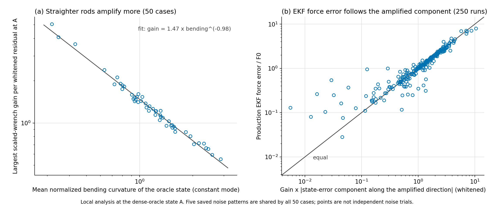

# Step 4: is the amplified direction stable across the dataset?

Not as a single fixed vector, but as a fixed, physically identifiable mode. Across all 50 saved cases the amplified direction is the quadratic bending mode, taken in each rod's own bending plane. Only 32% of cases fall within the preregistered tolerance of one common vector, so the preregistered single-direction rule is not met; the direction rotates with the bending plane, inside a two-dimensional subspace that holds a median 98% of it.

This mode accounts for the large force errors. Of the 179 runs (out of 250) where the production EKF force error exceeds 0.2 N, 178 have the error pointing along the amplified response. The gain grows as the rod gets straighter, close to inversely with its mean bending.

All 250 runs share five saved noise patterns and exact tendon tensions. This is a description of the existing dataset, not a noise-averaged statistic, and no remedy has been tested.

## Fixed scope and provenance

Date: 2026-10-12 (America/New_York). Source branch `diagnostic/oracle-ekf-gap`, HEAD `3508492ce7624d9b0cd53b3d84c0213d56f954dd`. All 50 case IDs in `gt_data/kirchhoff_gt_dataset.npz`, noise realizations 0–4, 250 runs. Settings are those of Steps 1–3: order `(2,2,1)`, gamma 10, sigma 0.5 degrees, 30 static EKF updates, three fixed offline starts.

Each run used the committed Step 3 runners, byte-unchanged (`run_registration.json` records their SHA256): `diagnose_recovered.py` for the A/B/C/D fits, then `diagnose_sensitivity.py`. All 250 runs exited with code 0, so every rank and derivative assertion passed; the largest finite-difference errors are 2.8e-09 for the measurement Jacobian and 9.2e-09 for the full wrench derivative.

`protocol.json` was written before the launch and fixes the direction definition, both descriptive rules and the reporting. A first launch stopped at its opening check, before any run, because the protocol contained a mistyped commit hash; the hash was corrected and nothing else changed.

The generator shares each noise realization across cases, so there are five noise patterns in total. Results are reported per noise pattern as well as pooled.

## Definition of the amplified direction

At the dense-oracle state A, let `H_s` be the whitened, curvature-scaled measurement Jacobian and `J_x` the scaled wrench derivative, as in Step 2. The amplified direction `v*` maximizes `||J_x v|| / ||H_s v||`. It is `pinv(H_s) r1`, with `r1` the top right singular vector of the saved operator `J_x pinv(H_s)`.

Steps 2 and 3 used the largest-gain individual singular vector of `H_s`. The two weakest singular values of `H_s` are nearly equal, so those individual vectors are not well defined; `v*` is. The two definitions give similar gains (median 1.22 versus 1.19).

## Preregistered results

**Stability across noise.** For a given case, `v*` is the same for every noise realization: the smallest cosine against that case's noise-0 direction is 0.9999999994. The direction is a property of the configuration, not of the noise draw.

**Stability across cases: single-direction rule not met.** The reference vector is the principal eigenvector of the mean of `v* v*^T` over the 50 cases. Only 16 of 50 cases (32%) have `|cos| >= 0.9` with it, against the preregistered 90%. The eigenvalues explain why: 0.550 and 0.416, then 0.018 and smaller. The directions fill a two-dimensional subspace rather than clustering around one vector.

**Dominance of the saved error.** The rule asks whether the actual A-to-estimate wrench change is aligned (`|cos| >= 0.9`) with the wrench response `J_x v*`.

| Noise pattern | Runs | EKF (D) aligned | Noisy offline fit (C) aligned | D median cosine | D median force error (N) | D median direction error |
|---|---:|---:|---:|---:|---:|---:|
| 0 | 50 | 92% | 94% | 0.998 | 0.541 | 42.3 deg |
| 1 | 50 | 94% | 92% | 0.997 | 0.415 | 38.5 deg |
| 2 | 50 | 90% | 96% | 0.997 | 0.318 | 35.4 deg |
| 3 | 50 | 88% | 94% | 0.997 | 0.426 | 35.4 deg |
| 4 | 50 | 74% | 74% | 0.978 | 0.173 | 20.2 deg |
| All | 250 | 87.6% | 90.0% | 0.996 | 0.355 | 32.0 deg |

Noise pattern 4 happens to project less onto the amplified direction (median whitened component 0.62, versus 0.89–1.44 for the others); its errors are correspondingly smaller and less aligned.

**Aggregate errors.** Over the 250 runs the EKF force-direction error has mean 40.8 degrees and median 32.0 degrees; the noisy offline fit has mean 42.9 degrees. The oracle A and noiseless fit B stay accurate (mean direction errors 0.8 and 3.6 degrees). The EKF mean is close to the manuscript's 44.2 degrees, but the runs here use the corrected EKF and this runner's settings, so this is a size comparison and not a reproduction of the manuscript table.

Across the 250 runs the scaled measurement condition stays between 7.25 and 7.66. The largest gain ranges from 0.55 to 5.06 (median 1.22), while the second singular value of the response operator stays near 0.105. The response is close to rank one: a single direction carries about ten times the gain of everything else.

## Post hoc: what the direction is

This section was added after seeing the results and is not covered by the protocol. The numbers are in the `post_hoc` block of `results/summary.json`.

- **It is the quadratic bending mode.** In the orthonormal curvature coordinates, the degree-2 bending modes of the two axes carry 84–94% of `v*` (median 92%); the linear bending modes carry most of the rest (median 7%), and torsion essentially none. Each case's direction lies a median 98% (minimum 88%) inside the two-dimensional subspace found above.
- **Its plane is the rod's own bending plane.** Within that subspace, `v*` is aligned with the direction of the oracle state's mean bending curvature: cosine median 0.999, minimum 0.972. This is the rotation that defeats the single-vector rule.
- **Straighter rods amplify more.** The gain follows mean bending with a log-log slope of −0.98 (correlation −0.993). Gain times mean bending stays within 1.34–1.65 over all 50 cases.
- **The response is almost pure force, mostly along the tip axis.** Force carries 97–99.9% of the squared scaled wrench response. In the true tip frame its axial component has median magnitude 0.82 of the unit force direction.
- **Size of the error.** The EKF force error divided by F0 matches gain times the whitened state-error component along `v*`: correlation 0.975, median ratio 1.01.
- **The unaligned runs are the small-error runs.** Median EKF force error is 0.396 N in the 219 aligned runs and 0.073 N in the 31 others. Among runs with error above 0.2 N, 178 of 179 are aligned.

For scale, the true force magnitude has median 0.369 N, and the EKF force error is a median 0.97 times the true force.



### Why the measurement is weak there (interpretation, not tested)

For small rotations, an IMU at normalized arc length `s` senses the integral of curvature from the base to `s`. The integral of the shifted degree-2 Legendre mode is `s(2s−1)(s−1)`, which is zero at `s = 0.5` and `s = 1`. The saved layout places its sensors at 0.2525, 0.5051 and 1.0 (at 0.5051 the integral is under 3% of its value at the first sensor), so to first order only the first sensor responds to this mode. That is consistent with the two weakest measurement singular values (about 18.5, against 52–54 and 136 for the others) and with the case-0 weakest singular vectors, which load 0.87–0.88 on the two quadratic bending modes.

The mechanics side is the familiar one: an axial tip force acts on the rod only through its lateral deflection, so for a nearly straight rod a small change in quadratic curvature corresponds to a large change in inferred axial force.

No run in this step changes the sensor layout, so the layout explanation remains a hypothesis that fits the saved spectra.

## Preservation and limits

Production code, datasets, saved states and all earlier diagnostic directories are unchanged; the only preexisting file edited is the diagnostic README index (`verification.json`). Full per-run outputs (about 33 MB) were written outside the repository and are not committed. `results/runs_compact.json` holds the per-run extraction, including the SHA256 of each full result, and `summarize_stability.py` reproduces `summary.json` from it byte for byte. Step 3 showed the runners reproduce saved outputs exactly.

Limits: local linear analysis at the oracle state; exact tendon tensions, routing and stiffness; one sensor layout; five shared noise patterns. The alignment and gain relations describe this dataset and are not a general observability result.

Recommended next action: test the layout hypothesis directly, since it is cheap and decides which remedy is worth building. The existing GT orientations allow sampling other sensor positions without new rod simulations, for example moving the middle sensor away from 0.5 toward where the quadratic mode's integral is large (it peaks near s = 0.21 and 0.79). Compare the gain along `v*` and the noisy offline-fit force error against the current layout. This needs new noise draws, so it should be run as a separate diagnostic with its own protocol. If the layout cannot change, the alternative is an estimator-side remedy for this one mode, such as a prior on in-plane quadratic bending or reporting axial force with its much larger uncertainty.

## Reproduce

From the repository root, with fresh output names:

```powershell
$step = 'diagnostics/oracle_ekf_gap/step4_direction_stability_20261012'
& '.\.venv\Scripts\python.exe' -B "$step/summarize_stability.py" --output-dir "$env:TEMP/step4-summary-new"
& '.\.venv\Scripts\python.exe' -B "$step/render_figures.py" --output-dir "$env:TEMP/step4-figures-new"
```

To regenerate a full run, use the Step 3 runners as documented in [Step 3](../step3_confirmation_20261012/README.md) with any `--case-id` and `--noise-realization`; `summarize_stability.py --runs-dir` rebuilds the compact extraction from a folder of such runs. `orchestration_as_run/run_all.py` is the launcher actually used (six parallel workers, about 22 minutes); it contains the original temporary paths and is kept as a record.
